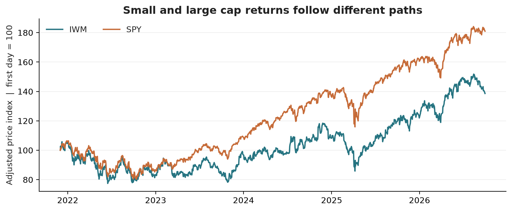
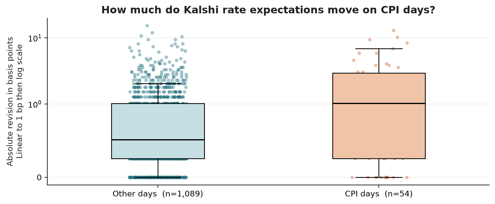
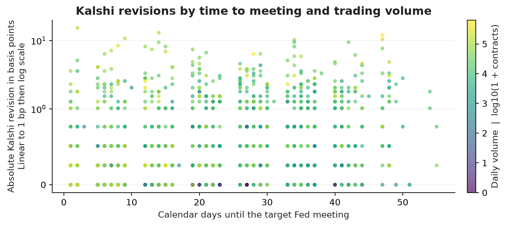
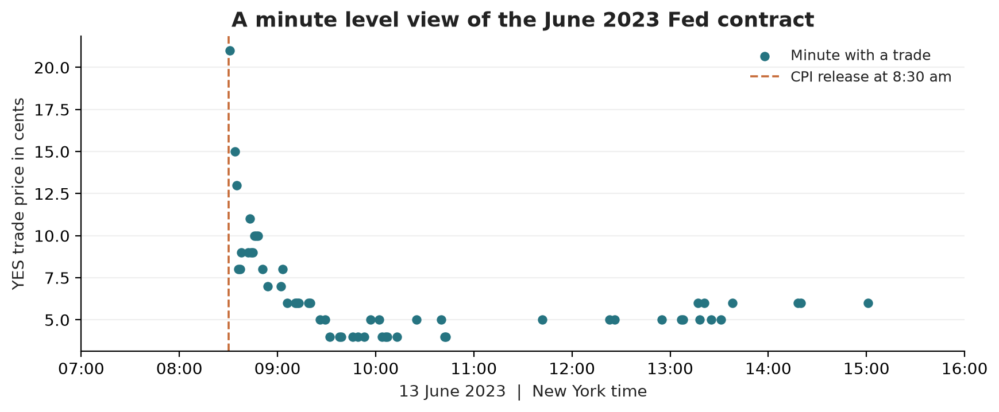

# Kalshi rate expectations and small-cap relative returns

A STAT GU4205/GR5205 linear regression project. We ask whether changes in Kalshi's expected Fed rate add information about IWM returns relative to SPY, beyond conventional market measures, and whether the association differs on CPI release days.

**[Read the project description](reports/project_description.md)** or **[download the Word document](reports/project_description.docx)**.

The description includes the research question, collected-data description, descriptive statistics, four commented plots, four nested models and objectives. Figure 3 shows three dimensions: meeting horizon, revision magnitude and trading volume.

## Get the data without running code

The collected data is included in this repository. Open a file below and use **Download raw file**, or choose **Code → Download ZIP** to get the whole project. No API calls or command-line downloads are needed to use this snapshot.

| File | Contents |
| --- | --- |
| [Daily project dataset](data/processed/daily_eda_candidate.csv) | 1,143 candidate dates with returns, Kalshi revisions, conventional controls, CPI indicators and meeting identifiers |
| [IWM and SPY adjusted prices](data/processed/etf_adjusted_prices.csv) | Daily adjusted prices used for the equity performance plot |
| [Treasury yields and VIX](data/processed/treasury_vix_daily.csv) | DGS2, DGS10 and VIXCLS in a regular CSV |
| [Daily equity factors](data/processed/equity_factors_daily.csv) | Market, size, value, profitability, investment and risk-free series in a regular CSV |
| [Kalshi minute example](data/processed/kalshi_1m_example.csv) | June 2023 contract candles, trade prices, bid/ask prices, volume and timestamps |
| [Kalshi hourly example](data/processed/kalshi_60m_example.csv) | The same contract at hourly frequency |
| [Full collected Kalshi daily expectations](data/raw/daily_moments_fed_levels.csv) | 7,657 source date-and-meeting observations |
| [Full collected Kalshi daily distributions](data/raw/daily_distributions_fed_levels.csv) | Source distributions across potential rate outcomes |

See the [data guide and column definitions](data/README.md). The minute and hourly files are verified examples for one contract and one requested day, not a full intraday history of every Fed contract. The daily project dataset remains preliminary pending timestamp alignment and quote-quality checks.

## Current data

The frozen daily collection was obtained on 4 November 2026. Its preliminary overlap contains **1,143 candidate dates, 40 Fed meeting targets and 54 CPI days**, from 2 December 2021 through 30 September 2026. Direct API downloads on 19 November 2026 also confirmed minute and hourly access for a June 2023 Fed contract.

The mean absolute source rate revision is **2.18 basis points on CPI days versus 0.90 on other days**. These are descriptive numbers. The research archive uses UTC daily data and can carry forward old trades. Alignment with the equity close and quote-quality checks remain necessary before estimating the final return regressions. No return-regression results are presented here.

**Before submission:** replace the four placeholder names and UNIs in [`config/team.json`](config/team.json). The assignment allows three to five team members. These details were not supplied when the draft was created.

## Four models

Let Y be the adjusted IWM return minus the adjusted SPY return; M the market excess return; T the change in the 2-year Treasury yield; V the change in VIX; C a Kalshi easing revision; and D the CPI-day indicator.

| Model | Added term | Question |
| --- | --- | --- |
| 1 | M, T and V | What do conventional market measures explain? |
| 2 | C | Does Kalshi add explanatory information? |
| 3 | D | Does the average relative return differ on CPI days? |
| 4 | C × D | Does the Kalshi slope differ on CPI days? |

In model 4 the Kalshi slope is eta on other days and eta + lambda on CPI days. This is a same-day observational study. It is not a causal policy experiment or a next-day trading forecast. Financial-constraint research motivates the size comparison; the design does not directly identify a borrowing-cost mechanism.

See [the methodology](docs/methodology.md) for units, formulas, timing rules, tests, robustness checks and how intraday data enters the project. [Sources](docs/sources.md) lists the data and literature.

## Figures









## Repository layout

```text
config/                 Team details and official announcement calendar
data/raw/               Collected source files included in the repository
data/processed/         Ready-to-open CSVs and intraday examples
data/metadata/          Source URLs, frozen-file hashes and sample counts
docs/                   Methodology and references
reports/                Word and Markdown project description
reports/figures/         Four final plots
reports/tables/          Descriptive statistics and comparison tables
src/                    Download, preparation, EDA and report scripts
tests/                  Timing and endpoint safeguards
```

The repository includes the frozen source files, processed CSVs, provenance, download code, summary tables and figures. Downloading the project also downloads these data files.

## Reproduce

To use the CSVs, just download them or the repository ZIP. To rebuild the tables and report from the included data, use Python 3.12 or later. From the repository root:

```bash
python -m venv .venv
source .venv/bin/activate
pip install -r requirements.txt
python src/prepare_data.py
python src/descriptive_analysis.py
python src/build_description.py
python -m unittest discover -s tests -v
```

`python src/download_data.py` is optional and only needed to fetch the inputs again. It uses public HTTP endpoints and needs no API key for the included examples. Source files can be updated or revised, so a later run need not be byte-identical to the frozen collection. Compare [`frozen_snapshot_manifest.json`](data/metadata/frozen_snapshot_manifest.json) and [`sample_summary.json`](data/metadata/sample_summary.json) before changing the reported numbers.

To download only the minute and hourly example, run `python src/download_data.py --intraday-only`. Candle requests are divided into windows below the API's 5,000-period limit. The script reads the current historical cutoff to select the correct endpoint.

The final-model command is:

```bash
python src/fit_models.py --input data/processed/daily_synchronized.csv
```

That synchronized file is a future estimation input, not an existing deliverable. The script intentionally rejects the preliminary EDA panel until timing and quality checks pass. All four models use the same observations and meeting-clustered uncertainty. The report has not been populated with speculative coefficients or significance claims.
