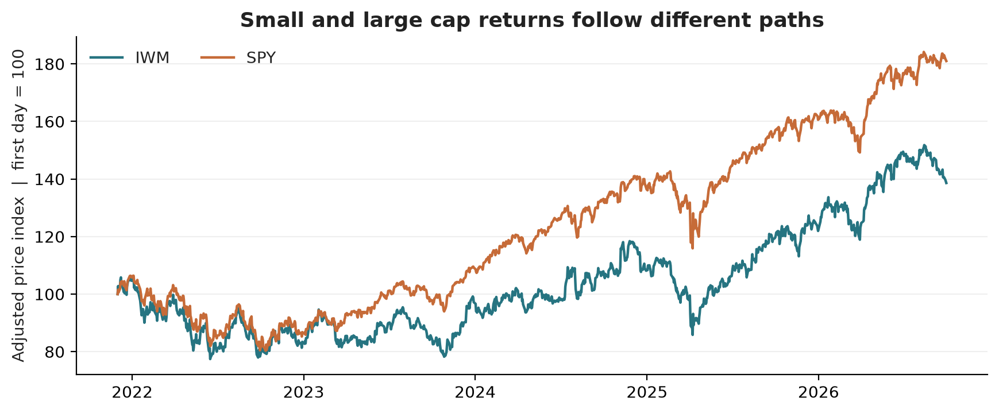
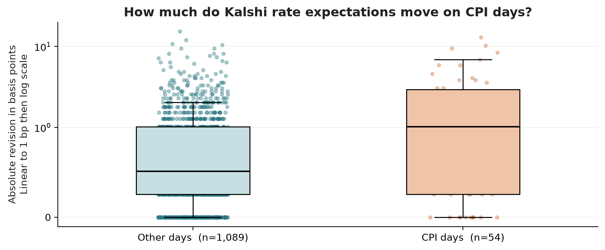
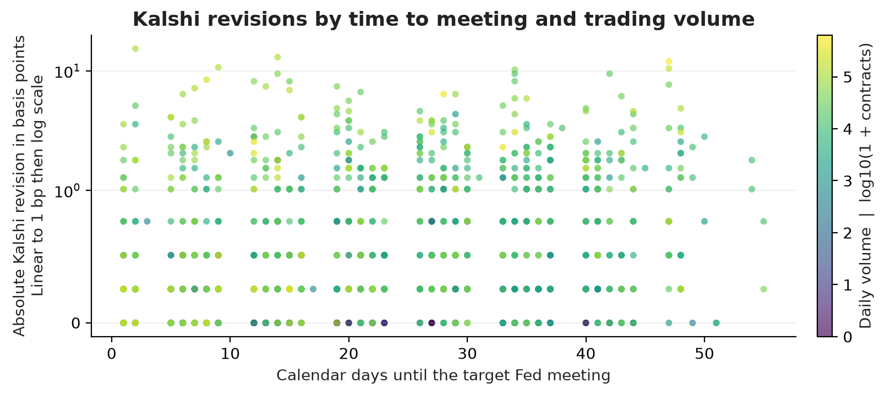
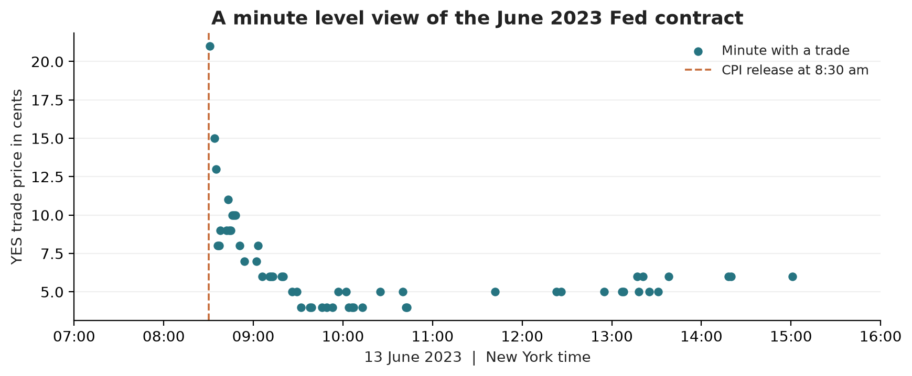

# Kalshi Rate Expectations and Small Cap Relative Returns

STAT GU4205 GR5205  |  Required project description  |  20 November 2026

## Research question

Do changes in Kalshi's expected Fed rate help explain small-cap returns relative to large-cap returns, beyond market returns, Treasury yields and VIX? Does this relationship differ on CPI release days?

We will study IWM, which tracks the Russell 2000, relative to SPY, which tracks the S&P 500. Prior research connects financing constraints with stronger responses to monetary policy. This motivates a size comparison, but our study will not directly test borrowing costs. We are studying same-day associations, rather than claiming that Kalshi causes stock returns or predicts tomorrow's return.

## Team members

| Name | UNI |
| --- | --- |
| [Add name] | [Add UNI] |
| [Add name] | [Add UNI] |
| [Add name] | [Add UNI] |
| [Add name] | [Add UNI] |

Complete the team list before submission. Four places are shown; the assignment allows three to five members.

## Data collected

Our daily data collection contains 7,657 Kalshi date-and-meeting observations from July 2021 to October 2026. These are expected rates derived by Diercks, Katz and Wright from contracts on different possible Fed outcomes. Other sources are Yahoo Finance for adjusted IWM and SPY prices, Kenneth French for equity factors, FRED for yields and VIX, and BLS and the Federal Reserve for announcement dates.

The preliminary overlap runs from 2 December 2021 to 30 September 2026: 1,143 candidate trading days, 40 Fed meeting targets and 54 CPI days. We compare the same upcoming meeting at both endpoints, exclude Fed decision days, and drop dates missing a required input. The sample ends in September because that is the endpoint of our collected equity-factor file.

We also downloaded minute and hourly candles directly from Kalshi for a June 2023 Fed contract. Hourly data will help align expectations with the equity close; minute data provides a closer view around CPI releases. The current daily archive uses UTC days, so its statistics below are preliminary. The synchronized sample for the final regressions has not yet been constructed.

## Variables and descriptive statistics

Y is the daily adjusted IWM return minus the adjusted SPY return. Positive Y means small caps outperformed large caps that day. C is yesterday's expected Fed rate minus today's expected rate, using the same meeting; positive C means expectations moved toward lower rates. One basis point is 0.01 percentage point.

M is the broad market excess return, T is the change in the 2-year Treasury yield, and V is the change in VIX. D equals 1 on an official CPI release day and 0 otherwise. The interaction is C multiplied by D.

| Variable and unit | Mean | SD | 5th pct | 95th pct |
| --- | --- | --- | --- | --- |
| Y  Relative return in pp | -0.02 | 0.75 | -1.17 | 1.19 |
| C  Kalshi revision in bp | -0.04 | 1.78 | -2.30 | 2.30 |
| M  Market return in % | 0.03 | 1.12 | -1.73 | 1.76 |
| T  Yield change in bp | 0.42 | 7.01 | -10.00 | 11.00 |
| V  VIX change in points | 0.00 | 1.72 | -2.26 | 2.56 |

All five rows use the same 1,143 candidate dates. SD is the standard deviation; pp means percentage points and bp means basis points. The 5th and 95th percentiles show the middle 90% of the observations.

Small caps underperformed by 0.02 percentage point per day on average, while the daily relative-return standard deviation was 0.75. This is a noisy outcome: most individual days tell us little on their own.

## CPI days and changes in expectations

| Day type | Days | Mean absolute C in bp | Median absolute C in bp |
| --- | --- | --- | --- |
| Other days | 1,089 | 0.90 | 0.51 |
| CPI days | 54 | 2.18 | 1.02 |

The average absolute revision is about 2.4 times larger on CPI days. This makes CPI a useful setting for the interaction question, although larger revisions do not by themselves imply a different stock-return slope.

About 20.9% of candidate days have no change in the source expectation. Only 1,077 of the 1,143 dates have positive reported target-contract volume at both endpoints. Unchanged expectations can reflect either little news or stale trading, so quote quality needs attention before estimation.

## Why these conventional controls

Market return accounts for unequal market exposure that may remain after subtracting the ETF returns. The 2-year yield gives us a conventional rate-market benchmark. VIX accounts for changes in expected equity volatility. Together they ask whether Kalshi adds information beyond familiar market measures. We will check their correlation rather than assume they are independent.

## Equity performance and CPI repricing

Figure 1. Adjusted prices indexed to 100 on 1 December 2021, through 30 September 2026. IWM gained 38.6% and SPY gained 81.0%. The gap motivates examining relative performance, but cannot be attributed to rate expectations alone. This plot uses all available equity dates in that period, not only the regression candidate dates.

Figure 2. Absolute Kalshi revisions on CPI and other candidate dates. The median is 1.02 bp on CPI days and 0.51 bp on other days. Points show individual observations; boxes show the middle half. The vertical scale is linear up to 1 bp and logarithmic above it. These are source UTC daily observations; no return-response conclusion is drawn here.

## Trading activity and the minute data

Figure 3. Three dimensions in one plot: days until the Fed meeting on the horizontal axis, absolute rate revision on the vertical axis, and daily target-contract volume in colour. The uneven activity and repeated zero changes show why more calendar observations do not always mean more information. Colour uses log10 of one plus volume so both low and high activity remain visible. This is descriptive evidence from the source daily series.

Figure 4. Minute trade prices for FED-23JUN-T5.25 on 13 June 2023. The contract paid YES if the upper-bound Fed rate was above 5.25% after the next day's meeting. The plotted prices range from 4 to 21 cents. There are 56 traded minutes shown, with no invented observations between them. The dashed line marks the 08:30 CPI release. A single threshold price is a probability measure, not the expected rate C used in the daily models.

## Four regression models

We will estimate the following models on one common synchronized daily sample. Each model adds one feature to the previous model.

**Model 1**

$$Y_t=\alpha+\beta_M M_t+\beta_T T_t+\beta_V V_t+\varepsilon_t$$

**Model 2**

$$Y_t=\alpha+\beta_M M_t+\beta_T T_t+\beta_V V_t+\eta C_t+\varepsilon_t$$

**Model 3**

$$Y_t=\alpha+\beta_M M_t+\beta_T T_t+\beta_V V_t+\eta C_t+\delta D_t+\varepsilon_t$$

**Model 4**

$$Y_t=\alpha+\beta_M M_t+\beta_T T_t+\beta_V V_t+\eta C_t+\delta D_t+\lambda C_tD_t+\varepsilon_t$$

Model 1 is the conventional benchmark. Model 2 adds Kalshi. Model 3 allows a different average return on CPI days. Model 4 also allows the Kalshi slope to change: it is η on other days and η + λ on CPI days. Thus λ = 0 tests whether the slopes differ. It does not test whether the stock return itself equals zero.

## Objectives for the analysis

- Test whether adding Kalshi improves explanatory fit and whether its coefficient differs from zero, after accounting for the conventional controls.

- Test whether CPI days have a different baseline relative return and a different sensitivity to Kalshi revisions. Report coefficient estimates and confidence intervals, including the CPI-day slope η + λ.

- Check whether any result survives stricter liquidity filters, influential-date checks and changes in the meeting cycles included.

## Estimation and checks

We will use OLS and allow errors to be related within the same Fed meeting cycle. We will inspect residuals, multicollinearity and influential observations, then compare with Huber robust regression and leave one meeting cycle out at a time. The main models use a small control set. Style factors and the yield-curve slope are secondary checks; SMB closely resembles the relative-size outcome.

Hourly and minute observations will first improve timing and data-quality checks. A separate hourly return regression would also need matched intraday equity prices and controls. We will not treat extra minute bars as extra independent CPI events. No return regressions or significance results are claimed in this preliminary description.

## Selected sources

[Kalshi data and construction  Diercks Katz and Wright public research archive](https://github.com/jdkatz21/Prediction_Markets_Public)

[Kalshi historical minute and hourly candlestick documentation](https://docs.kalshi.com/api-reference/historical/get-historical-market-candlesticks)

[Daily equity factors  Kenneth French data library](https://mba.tuck.dartmouth.edu/pages/faculty/ken.french/data_library.html)

[Motivation  Ehrmann and Fratzscher 2004 Taking Stock](https://www.ecb.europa.eu/pub/pdf/scpwps/ecbwp354.pdf)

Full source links, retrieval records, data definitions and reproducible Python scripts accompany this description in the repository.

